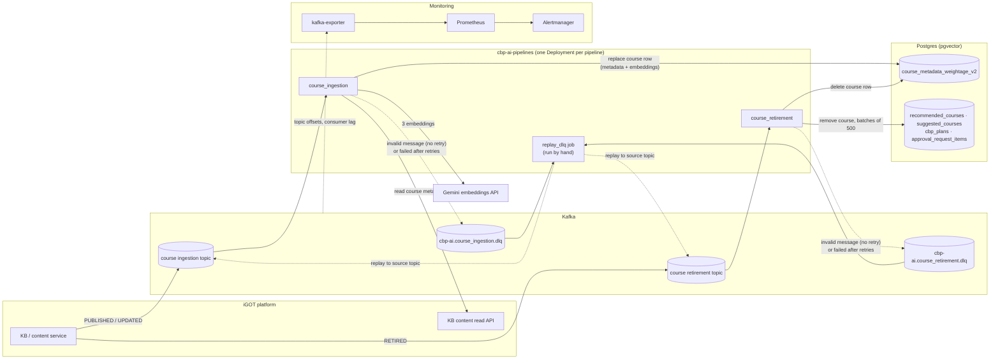
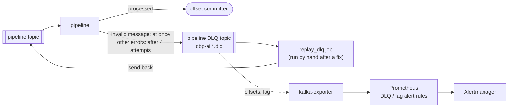

# CBP AI Pipelines

Kafka-driven workers that keep CBP's course data in sync with KB courses on the iGOT platform:

* **course_ingestion** indexes a course (its metadata and three Gemini embeddings) into
  `course_metadata_weightage_v2` when it is published or updated.
* **course_retirement** removes a retired course from `course_metadata_weightage_v2` and from every
  plan, recommendation, suggestion and approval that references it.

Design documents: [course ingestion](docs/course_ingestion_pipeline_design.md) ·
[course retirement](docs/course_retirement_pipeline_design.md)

## Contents

1. [Pipelines supported](#pipelines-supported)
2. [High-level architecture](#high-level-architecture)
3. [Folder structure](#folder-structure)
4. [Prerequisites](#prerequisites)
5. [Configuration](#configuration)
6. [Run locally (without Docker)](#run-locally-without-docker)
7. [Run with Docker](#run-with-docker)
8. [Kafka topics and test messages](#kafka-topics-and-test-messages)
9. [Checking results](#checking-results)
10. [Dead-letter queue (DLQ) and the replay job](#dead-letter-queue-dlq-and-the-replay-job)
11. [Monitoring and DLQ alerts (Prometheus)](#monitoring-and-dlq-alerts-prometheus)
12. [Event formats](#event-formats)
13. [Processing guarantees](#processing-guarantees)
14. [Health checks (heartbeat)](#health-checks-heartbeat)
15. [Building the image and Jenkins](#building-the-image-and-jenkins)
16. [Deploying to Kubernetes](#deploying-to-kubernetes)
17. [Operations runbook](#operations-runbook)
18. [Troubleshooting](#troubleshooting)
19. [Adding a new pipeline](#adding-a-new-pipeline)

---

## Pipelines supported

The framework runs **any number of pipelines**. Each one is a folder plus one line in
`registry.py`, and runs as its own process with its own Kafka topic, consumer group and DLQ topic,
so pipelines can be deployed, scaled and replayed independently.

Currently **2 pipelines** and **1 job** are available:

| Pipeline | Topic setting (default) | Triggered by | What it does | Needs Gemini |
|---|---|---|---|---|
| `course_ingestion` | `KAFKA_COURSE_INGESTION_TOPIC` (`local.course.ingestion`) | `operationType: PUBLISHED / UPDATED` for a Course (any other message → DLQ as `InvalidEventError`) | Reads the course from the KB content read API → 3 Gemini embeddings → replaces its row in `course_metadata_weightage_v2` | Yes |
| `course_retirement` | `KAFKA_COURSE_RETIREMENT_TOPIC` (`local.course.retirement`) | `operationType: RETIRED` (any other message → DLQ as `InvalidEventError`) | Deletes the row from `course_metadata_weightage_v2`, then removes the course from `recommended_courses`, `suggested_courses`, `cbp_plans` and `approval_request_items` (all statuses), 500 rows per transaction | No |

| Job | What it does |
|---|---|
| `replay_dlq` | Sends messages from a pipeline's DLQ topic back to their source topic, with loop protection |

List them from the code:

```bash
uv run python -m src.runner --list
```

For a full reload of the table, or a bulk clean-up of many retired courses, use the batch scripts
in the cbp-ai-service repository: `scripts/course_embedding_pipeline_v2.py` (CSV load) and
`scripts/remove_retired_courses.py`.

---

## High-level architecture



### Failures, replay and alerts



* No message is dropped: it is either processed or written to the pipeline's DLQ with the reason in
  its headers.
* `replay_dlq` sends DLQ messages back to their topic once the cause is fixed; invalid messages are
  fixed at the sender instead.
* Alerts come from Kafka metrics through kafka-exporter; the workers expose no metrics of their own.

### Inside a worker

Each worker runs this loop (`common/worker.py`):

1. **Poll** up to `KAFKA_MAX_POLL_RECORDS` messages.
2. **Validate and parse** each message into the pipeline's event type. Nothing is silently ignored:
   a message that fails validation (empty, invalid JSON, wrong format) goes straight to the DLQ as
   `InvalidEventError`, without retries.
3. **Dedupe**: several events for the same course in one batch collapse to the latest one.
4. **Handle** events in parallel (up to `PIPELINE_CONCURRENCY`), retrying failures with backoff.
5. **Dead-letter** anything that still fails, and every invalid message (no retry), to the
   pipeline's DLQ topic.
6. **Commit** offsets, only after every message was handled or dead-lettered.

Events are triggers, not data: ingestion always re-reads the course from the KB content read API
(`GET /api/content/v4/read/<id>?fields=…`) before writing, so duplicate, missed or out-of-order
events can't leave the table in a wrong state.

---

## Folder structure

```
ai-cbp-pipelines/
├── src/
│   (see below)
├── tests/                     Unit tests (pytest, no Kafka or Postgres needed)
├── scripts/
│   └── publish_test_event.py  Send a test retirement event
├── docs/                      Design documents for both pipelines
├── Dockerfile                 Image for workers and jobs
├── build.sh                   Build script used by Jenkins
├── Jenkinsfile                Jenkins job for the image
├── .env.example               Settings template; copy to .env
├── pyproject.toml / uv.lock   Dependencies (uv)
└── README.md

src/
├── runner.py                  Entry point: python -m src.runner <pipeline>
├── registry.py                Pipeline name → class (add new pipelines here)
├── common/                    Shared framework, used by every pipeline
│   ├── settings.py            PipelineSettings (environment variables / .env)
│   ├── base_pipeline.py       Contract every pipeline implements: topics(), parse(), handle()
│   ├── worker.py              Poll → parse → dedupe → handle with retry → DLQ → commit
│   ├── errors.py              SkipEvent / NonRetryableError / InvalidEventError / StaleReadError / FatalPipelineError / EmbeddingError
│   ├── types.py               Outcome and HandleResult
│   ├── kafka/                 Consumer (manual commits), producer (idempotent), DLQ publisher, SSL/SASL
│   ├── content_client.py      KB API client: read_content(id, fields) (used) and search_content(body), with retries
│   ├── embedding_client.py    Gemini embeddings with a concurrency cap
│   ├── course_repository.py   COURSE_TABLE and row deletes with per-course advisory locks
│   ├── schema.py              Table, extensions and indexes (IF NOT EXISTS)
│   ├── context.py             DB pool and clients, created once per process
│   ├── health.py              Heartbeat file for liveness probes
│   └── log.py                 Logging setup
├── course_ingestion/
│   ├── pipeline.py            CourseIngestionEvent, parse() and handle()
│   ├── indexer.py             KB content read lookup (LOOKUP_FIELDS) and KbCourseIndexer (embeddings + metadata row)
│   └── utils.py               Status values, course-ID pattern, is_course(), is_older(), embedding text
├── course_retirement/
│   ├── pipeline.py            RetirementEvent, parse() and handle()
│   └── references.py          Removes a course from plans, recommendations, suggestions, approvals
└── jobs/
    └── replay_dlq.py          DLQ → source topic
```

---

## Prerequisites

| What | Why | Notes |
|---|---|---|
| **Python 3.12** and **[uv](https://docs.astral.sh/uv/)** | Run the code; install dependencies from `uv.lock` | `brew install uv`, then `uv sync` in the repo root |
| **Apache Kafka** (3.x or 4.x, KRaft) | Event source, DLQ topics | Locally: download from [kafka.apache.org/downloads](https://kafka.apache.org/downloads). Needs **Java 17+** (`brew install openjdk@17`) |
| **PostgreSQL 14+ with pgvector** | `course_metadata_weightage_v2` and the CBP tables | Locally: `brew install postgresql@17 pgvector`. The `vector` and `pg_trgm` extensions are created at startup |
| **GCP / Gemini API key** | Embeddings for `course_ingestion` | A Google Cloud project (or Google AI Studio) key with the **Gemini API** enabled and enough quota for `gemini-embedding-2`. Not needed for `course_retirement` |
| **KB API base URL and token** | `course_ingestion` re-reads each course from the KB content read API | Same values as the API's `.env`. `course_retirement` doesn't call KB but the settings are still required |
| **Docker** (optional) | Run the pipelines as containers | Docker Desktop on Mac |
| **Prometheus + kafka-exporter** (optional) | DLQ and lag alerts | See [Monitoring](#monitoring-and-dlq-alerts-prometheus) |

---

## Configuration

Settings are read from environment variables, or from `.env` in the directory you run from.
**Environment variables take priority over `.env`.** Start from the template:

```bash
cp .env.example .env
```

Every setting and its default is in `src/common/settings.py`.

The course table is fixed in code (`COURSE_TABLE = "course_metadata_weightage_v2"` in
`common/course_repository.py`), not read from the environment.

### Required

| Variable | Used by | Example |
|---|---|---|
| `DATABASE_URL` | All | `postgresql://localhost:5432/cbp_local` (the `postgresql+asyncpg://` form also works) |
| `KB_BASE_URL` | All (only `course_ingestion` calls it) | `https://<kb-host>` |
| `KB_AUTH_TOKEN` | All (only `course_ingestion` calls it) | `Bearer <token>` (sent as the `Authorization` header as-is) |
| `GOOGLE_API_KEY` | `course_ingestion` | Gemini API key |

### Topics

| Variable | Default | Notes |
|---|---|---|
| `KAFKA_COURSE_INGESTION_TOPIC` | `local.course.ingestion` | Topic `course_ingestion` reads. **Must carry ingestion events only**: every other message is dead-lettered as `InvalidEventError` |
| `KAFKA_COURSE_RETIREMENT_TOPIC` | `local.course.retirement` | Topic `course_retirement` reads. **Must carry retirement events only**: every other message is dead-lettered as `InvalidEventError` |
| `KAFKA_CONSUMER_GROUP_PREFIX` | `cbp-ai` | Consumer group is `<prefix>.<pipeline>`, e.g. `cbp-ai.course_ingestion` |
| `KAFKA_DLQ_TOPIC_TEMPLATE` | `{prefix}.{pipeline}.dlq` | e.g. `cbp-ai.course_ingestion.dlq` |

### Kafka connection and consumer

| Variable | Default | Notes |
|---|---|---|
| `KAFKA_BOOTSTRAP_SERVERS` | `localhost:9092` | Comma-separated |
| `KAFKA_SECURITY_PROTOCOL` | `PLAINTEXT` | `PLAINTEXT`, `SSL`, `SASL_PLAINTEXT`, `SASL_SSL` |
| `KAFKA_SASL_MECHANISM` | empty (`PLAIN` when SASL is on) | `PLAIN`, `SCRAM-SHA-256`, `SCRAM-SHA-512` |
| `KAFKA_SASL_USERNAME` / `KAFKA_SASL_PASSWORD` | empty | |
| `KAFKA_SSL_CAFILE` | empty | Path to a CA bundle for SSL |
| `KAFKA_AUTO_OFFSET_RESET` | `earliest` | Where a brand-new consumer group starts |
| `KAFKA_MAX_POLL_RECORDS` | `50` | Batch size. Lower it (e.g. `10`) for `course_retirement` |
| `KAFKA_POLL_TIMEOUT_MS` | `1000` | How long an empty poll waits |
| `KAFKA_MAX_POLL_INTERVAL_MS` | `600000` | Must be longer than the slowest batch |
| `KAFKA_SESSION_TIMEOUT_MS` | `30000` | |

### Processing

| Variable | Default | Notes |
|---|---|---|
| `PIPELINE_CONCURRENCY` | `10` | Events handled in parallel per batch |
| `PIPELINE_MAX_ATTEMPTS` | `4` | Attempts before a message is dead-lettered |
| `PIPELINE_RETRY_BACKOFF_SECONDS` | `5` | Doubles each attempt: 5s, 10s, 20s |
| `PIPELINE_HEARTBEAT_FILE` | `/tmp/pipeline-heartbeat` | See [Health checks](#health-checks-heartbeat) |
| `LOG_LEVEL` | `INFO` | `DEBUG` for more detail |

### Database and embeddings

| Variable | Default | Notes |
|---|---|---|
| `DB_POOL_MIN_SIZE` / `DB_POOL_MAX_SIZE` | `1` / `10` | Per process |
| `KB_HTTP_TIMEOUT_SECONDS` | `60` | |
| `KB_HTTP_RETRIES` | `2` | Per request, inside each pipeline attempt |
| `GOOGLE_EMBEDDING_MODEL` | `gemini-embedding-2` | Must match the model used for existing rows |
| `EMBEDDING_OUTPUT_DIMENSIONALITY` | `1536` | Must match the table's vector columns |
| `EMBEDDING_CONCURRENCY` | `20` | Max parallel Gemini calls per process |

---

## Run locally (without Docker)

> Use a **local** database. The pipelines write and delete rows; never point them at a shared one.

### 1. Start Kafka

From the folder where you extracted Kafka (`kafka_2.13-<version>`):

```bash
# One-time: format storage (KRaft mode, no ZooKeeper)
KAFKA_CLUSTER_ID="$(bin/kafka-storage.sh random-uuid)"
bin/kafka-storage.sh format --standalone -t "$KAFKA_CLUSTER_ID" -c config/server.properties

# Start the broker (keep this terminal open) → localhost:9092
bin/kafka-server-start.sh config/server.properties
```

On Kafka 3.x the config file is `config/kraft/server.properties`. Stop with `Ctrl+C`.

### 2. Create the topics

See [Create topics](#create-topics). Every pipeline needs its topic **and** its DLQ topic.

### 3. Start Postgres and create the tables

```bash
brew services start postgresql@17
createdb cbp_local
```

The pipelines create `course_metadata_weightage_v2` and its indexes at startup. The retirement
pipeline also needs the app tables (`cbp_plans`, `recommended_courses`, …), which belong to the
**cbp-ai-service** API. Run the API once against the local database (from the cbp-ai-service
repository), then stop it with `Ctrl+C`:

```bash
cd ../cbp-ai-service
DATABASE_URL=postgresql+asyncpg://localhost:5432/cbp_local uv run uvicorn src.main:app
```

To test with realistic plans and recommendations, restore a dump of the dev database into
`cbp_local` instead.

### 4. Set the environment

Export in the shell so your `.env` stays untouched (exports win over `.env`):

```bash
export DATABASE_URL=postgresql://localhost:5432/cbp_local
export KAFKA_BOOTSTRAP_SERVERS=localhost:9092
export KAFKA_SECURITY_PROTOCOL=PLAINTEXT              # in case .env has a remote cluster's SASL settings
export KAFKA_COURSE_INGESTION_TOPIC=local.course.ingestion
export KAFKA_COURSE_RETIREMENT_TOPIC=local.course.retirement
export KB_BASE_URL=https://<kb-host>
export KB_AUTH_TOKEN="Bearer <token>"
export GOOGLE_API_KEY=<gemini-key>                    # course_ingestion only
```

### 5. Run a pipeline

Each pipeline runs in its own terminal:

```bash
uv sync
uv run python -m src.runner course_ingestion
uv run python -m src.runner course_retirement
```

Expected start-up log:

```
INFO [cbp_pipelines.schema] Schema for course_metadata_weightage_v2 is ready
INFO [cbp_pipelines.runner] Starting course_retirement (group=cbp-ai.course_retirement, dlq=cbp-ai.course_retirement.dlq)
INFO [cbp_pipelines.course_retirement.worker] Consuming local.course.retirement
```

Stop with `Ctrl+C`: the worker finishes the batch it is processing, commits, and exits.

Then [send a test message](#send-test-messages).

### 6. Run the unit tests

The tests use fakes, so they need neither Kafka nor Postgres:

```bash
uv run pytest
```

---

## Run with Docker

The image runs the same code; only Kafka and Postgres addresses change, because inside a container
`localhost` is the container itself.

### 1. Let containers reach Kafka on your Mac

Kafka tells clients which address to connect to (`advertised.listeners`). Add a second listener for
containers: in `config/server.properties`, **replace** these three existing lines, then restart
Kafka:

```properties
listeners=PLAINTEXT://:9092,DOCKER://:29092,CONTROLLER://:9093
advertised.listeners=PLAINTEXT://localhost:9092,DOCKER://host.docker.internal:29092,CONTROLLER://localhost:9093
listener.security.protocol.map=CONTROLLER:PLAINTEXT,PLAINTEXT:PLAINTEXT,DOCKER:PLAINTEXT
```

Tools on your Mac keep using `localhost:9092`; containers use `host.docker.internal:29092`.

### 2. Build the image

```bash
docker build -f Dockerfile -t cbp-ai-pipelines:dev .
docker run --rm cbp-ai-pipelines:dev            # lists the pipelines
```

### 3. Create an env file for containers

`pipelines.docker.env` (don't commit it; it holds secrets):

```bash
DATABASE_URL=postgresql://<your-mac-user>@host.docker.internal:5432/cbp_local
KAFKA_BOOTSTRAP_SERVERS=host.docker.internal:29092
KAFKA_SECURITY_PROTOCOL=PLAINTEXT
KAFKA_COURSE_INGESTION_TOPIC=local.course.ingestion
KAFKA_COURSE_RETIREMENT_TOPIC=local.course.retirement
KB_BASE_URL=https://<kb-host>
KB_AUTH_TOKEN=Bearer <token>
GOOGLE_API_KEY=<gemini-key>
```

No quotes around values in an env file.

### 4. Run the pipelines and jobs

```bash
docker run --rm --name course-ingestion  --env-file pipelines.docker.env cbp-ai-pipelines:dev src.runner course_ingestion
docker run --rm --name course-retirement --env-file pipelines.docker.env cbp-ai-pipelines:dev src.runner course_retirement

# Jobs
docker run --rm --env-file pipelines.docker.env cbp-ai-pipelines:dev src.jobs.replay_dlq course_ingestion --dry-run
```

Stop a worker with `docker stop course-ingestion` (it finishes the current batch and commits).

---

## Kafka topics and test messages

Run these from the Kafka folder. On a remote cluster, replace `localhost:9092` and add
`--command-config client.properties` with its SSL/SASL settings.

### Create topics

```bash
# Pipeline topics
bin/kafka-topics.sh --bootstrap-server localhost:9092 --create --topic local.course.ingestion  --partitions 3
bin/kafka-topics.sh --bootstrap-server localhost:9092 --create --topic local.course.retirement --partitions 1

# DLQ topics: one per pipeline, named cbp-ai.<pipeline>.dlq
bin/kafka-topics.sh --bootstrap-server localhost:9092 --create --topic cbp-ai.course_ingestion.dlq
bin/kafka-topics.sh --bootstrap-server localhost:9092 --create --topic cbp-ai.course_retirement.dlq

# Check
bin/kafka-topics.sh --bootstrap-server localhost:9092 --list
bin/kafka-topics.sh --bootstrap-server localhost:9092 --describe --topic local.course.ingestion
```

Partitions limit parallelism: replicas beyond a topic's partition count sit idle. Retirement should
run one replica, so one partition is enough.

Each pipeline's topic must carry **only** that pipeline's events: every other message is sent to the
pipeline's DLQ as invalid. Don't share a topic between ingestion and retirement.

### Send test messages

Ingestion reads the course from KB, so use the identifier of a **real** course in the environment
`KB_BASE_URL` points at.

**Console producer** (one JSON message per line, `Ctrl+D` to exit):

```bash
bin/kafka-console-producer.sh --bootstrap-server localhost:9092 --topic local.course.ingestion
```

```json
{"identifier":"do_12345","operationType":"PUBLISHED","objectType":"Content","primaryCategory":"Course","courseCategory":"Course","contentType":"Course","transactionData":{"properties":{"status":{"ov":"Processing","nv":"Live"},"versionKey":{"ov":"1700000000000","nv":"1700000005000"}}}}
```

```bash
bin/kafka-console-producer.sh --bootstrap-server localhost:9092 --topic local.course.retirement
```

```json
{"identifier":"do_12345","operationType":"RETIRED"}
```

**With a key** (same key = same partition, so events for one course stay in order):

```bash
bin/kafka-console-producer.sh --bootstrap-server localhost:9092 --topic local.course.retirement \
  --property parse.key=true --property key.separator='|'
```

```
do_12345|{"identifier":"do_12345","operationType":"RETIRED"}
```

**Helper script** (retirement events only, from the repo root; it can't build the full ingestion
event, so use the console producer for ingestion):

```bash
uv run python scripts/publish_test_event.py --topic local.course.retirement --identifier do_12345 --operation-type RETIRED
```

**Test the validation** (each of these lands in `cbp-ai.course_retirement.dlq` as `InvalidEventError`,
without retries):

```bash
# operationType missing
uv run python scripts/publish_test_event.py --topic local.course.retirement --identifier do_12345
# identifier not a do_ id
uv run python scripts/publish_test_event.py --topic local.course.retirement --identifier abc-1 --operation-type RETIRED
```

The worker logs `Dead-lettered ... InvalidEventError: <reason>`; [view the DLQ](#view-dlq-messages)
to see the headers.

> For ingestion tests, use a **real** course ID in that KB environment (an unknown ID is dead-lettered
> with `not found in KB`) and its real `versionKey`, or leave `versionKey` out. A made-up value newer
> than KB's makes the event fail with `StaleReadError` and end up in the DLQ.

### Read a topic

```bash
bin/kafka-console-consumer.sh --bootstrap-server localhost:9092 --topic local.course.ingestion \
  --from-beginning --property print.key=true
```

---

## Checking results

### Worker logs

Each event logs one line and each batch one summary:

```
INFO [cbp_pipelines.course_ingestion.worker] do_12345 -> inserted
INFO [cbp_pipelines.course_retirement.worker] do_12345 -> deleted (course_metadata_weightage_v2 1 row(s); references: cbp_plans 7/7 (rows/entries))
INFO [cbp_pipelines.course_ingestion.worker] Batch of 3 message(s): dead_lettered=1, inserted=1, unchanged=1
```

| Outcome | Meaning |
|---|---|
| `inserted` / `updated` | Row written |
| `unchanged` | Table already up to date: same `versionKey` stored (no Gemini call), or the course is Retired in KB and not in the table |
| `deleted` | Row and/or references removed |
| `skipped` | Retirement only: the course was not in the table or referenced anywhere, so nothing to remove |
| `superseded` | A later event for the same course was in the same batch |
| `dead_lettered` | Sent to the DLQ |

### Database

```sql
SELECT identifier, name, version_key, vector_dims(combined_embedding)
FROM course_metadata_weightage_v2
WHERE identifier = 'do_12345';
```

### Consumer lag (how far behind a pipeline is)

```bash
bin/kafka-consumer-groups.sh --bootstrap-server localhost:9092 --describe --group cbp-ai.course_ingestion
```

The `LAG` column is the number of unprocessed messages per partition.

---

## Dead-letter queue (DLQ) and the replay job

### When a message goes to the DLQ

| Failure | Retried? | Ends in DLQ |
|---|---|---|
| KB still returns an older `versionKey` than the event (`StaleReadError`) | Yes: 5s, 10s, 20s | After 4 attempts |
| KB API 5xx / timeout, Gemini error / quota, DB connection drop, lock timeout | Yes: 5s, 10s, 20s | After 4 attempts |
| Message failing validation: empty, invalid JSON, wrong format (`InvalidEventError`) | No | Immediately |
| Ingestion: course not found in KB (404), not a Course, or not Live / Retired (`NonRetryableError`) | No | Immediately |
| KB API other 4xx (`NonRetryableError`) | No | Immediately |
| KB token rejected 401/403 (`FatalPipelineError`) | — | **Never**: the worker stops without committing and restarts |

The offset is committed after the message is safely in the DLQ, so the pipeline keeps going.

### What a DLQ message contains

The original key and value, unchanged, plus these headers:

| Header | Value |
|---|---|
| `x-pipeline` | Pipeline that failed |
| `x-source-topic` / `x-source-partition` / `x-source-offset` | Where the message came from |
| `x-error-type` / `x-error-message` | Why it failed |
| `x-attempts` | How many attempts were made |
| `x-failed-at` | UTC timestamp |
| `x-replay-count` | How many times `replay_dlq` has already sent it back |

### View DLQ messages

```bash
bin/kafka-console-consumer.sh --bootstrap-server localhost:9092 --topic cbp-ai.course_ingestion.dlq \
  --from-beginning --property print.headers=true --property print.key=true
```

### Replay with the `replay_dlq` job

Fix the cause first, then replay. Don't replay `InvalidEventError` messages unchanged: they fail
validation again and go straight back to the DLQ (and count towards `--max-replays`). Fix the
producer and re-publish a corrected message instead.

```bash
# Preview: what would be replayed; sends and commits nothing
uv run python -m src.jobs.replay_dlq course_ingestion --dry-run

# Replay everything to each message's source topic
uv run python -m src.jobs.replay_dlq course_ingestion

# Options
uv run python -m src.jobs.replay_dlq course_ingestion --max-messages 100
uv run python -m src.jobs.replay_dlq course_ingestion --target-topic local.course.ingestion
```

| Option | Default | Meaning |
|---|---|---|
| `--dry-run` | off | Log what would happen; send and commit nothing |
| `--max-messages` | `10000` | Stop after this many DLQ messages |
| `--max-replays` | `3` | Skip messages already replayed this many times (logged as `parked`) |
| `--target-topic` | each message's `x-source-topic` | Send everything to this topic instead |

How it works:

* It uses its own consumer group, `cbp-ai.<pipeline>.dlq-replay`, so it remembers what it already
  replayed. Messages stay in the DLQ topic (until Kafka retention removes them); the job only moves
  its own position forward.
* **One pass per run:** only messages that were in the DLQ when the job started are replayed. A
  replayed message that fails again lands after that cut-off and waits for the next run.
* **Replay limit:** each replay increments `x-replay-count`. After `--max-replays` replays, the job
  skips the message as `parked`. With defaults a message is tried at most 16 times in total.
* Keep the pipeline running while you replay so it picks the messages up.
* Run it by hand after fixing a problem; don't schedule it.

---

## Monitoring and DLQ alerts (Prometheus)

The workers don't expose metrics themselves. Everything needed comes from Kafka through
[kafka-exporter](https://github.com/danielqsj/kafka_exporter), which publishes per-topic offsets and
per-consumer-group lag:

| Metric | Used for |
|---|---|
| `kafka_topic_partition_current_offset{topic}` | Messages written to a DLQ topic |
| `kafka_consumergroup_lag{consumergroup, topic}` | Pipeline backlog; DLQ messages not yet replayed |

### 1. Run kafka-exporter

```bash
# Locally (Docker), against Kafka on your Mac
docker run --rm -p 9308:9308 danielqsj/kafka-exporter --kafka.server=host.docker.internal:29092

curl -s localhost:9308/metrics | grep 'topic="cbp-ai'
```

In Kubernetes, run it as a Deployment next to Kafka and let Prometheus scrape port `9308`.

### 2. Alert rules

Thresholds are starting points; tune them after watching normal traffic for a week.

```yaml
# prometheus/cbp-ai-pipelines.rules.yml
groups:
  - name: cbp-ai-pipelines
    rules:
      # New messages in a DLQ: something is failing repeatedly.
      - alert: CbpAiDlqMessagesWarning
        expr: |
          sum by (topic) (
            increase(kafka_topic_partition_current_offset{topic=~"cbp-ai\\..+\\.dlq"}[15m])
          ) > 5
        labels:
          severity: warning
        annotations:
          summary: "{{ $labels.topic }}: {{ $value | humanize }} messages dead-lettered in 15 min"
          description: "Check x-error-type in the DLQ headers. InvalidEventError: fix the sender and re-publish. Otherwise fix the cause, then run replay_dlq."

      - alert: CbpAiDlqMessagesCritical
        expr: |
          sum by (topic) (
            increase(kafka_topic_partition_current_offset{topic=~"cbp-ai\\..+\\.dlq"}[15m])
          ) > 50
        labels:
          severity: critical
        annotations:
          summary: "{{ $labels.topic }}: {{ $value | humanize }} messages dead-lettered in 15 min"
          description: "Likely an outage (KB API, Gemini quota, database) or a sender changed its event format (InvalidEventError). Pipeline keeps running; failures pile up in the DLQ."

      # DLQ messages waiting to be replayed (only once replay_dlq has run at least once for the pipeline).
      - alert: CbpAiDlqNotReplayed
        expr: |
          sum by (consumergroup, topic) (
            kafka_consumergroup_lag{consumergroup=~"cbp-ai\\..+\\.dlq-replay"}
          ) > 0
        for: 24h
        labels:
          severity: warning
        annotations:
          summary: "{{ $labels.topic }}: {{ $value }} DLQ messages not replayed for 24h"

      # A pipeline falling behind its topic.
      - alert: CbpAiPipelineLagHigh
        expr: |
          sum by (consumergroup) (
            kafka_consumergroup_lag{consumergroup=~"cbp-ai\\.course_(ingestion|retirement)"}
          ) > 500
        for: 15m
        labels:
          severity: warning
        annotations:
          summary: "{{ $labels.consumergroup }} is {{ $value }} messages behind"
          description: "Check the pods are running and not restarting; consider lowering KAFKA_MAX_POLL_RECORDS or adding replicas (ingestion only)."
```

Load it in `prometheus.yml`:

```yaml
rule_files:
  - prometheus/cbp-ai-pipelines.rules.yml
```

With the Prometheus Operator, put the same `groups:` under `spec:` of a `PrometheusRule`
(`apiVersion: monitoring.coreos.com/v1`) with the labels your Prometheus selects on. Route
`severity` to the team's channel in Alertmanager.

Check the expressions in the Prometheus UI before enabling the alerts, e.g.:

```promql
sum by (topic) (increase(kafka_topic_partition_current_offset{topic=~"cbp-ai\\..+\\.dlq"}[15m]))
```

---

## Event formats

### course_ingestion

```json
{
  "identifier": "do_12345",
  "operationType": "PUBLISHED",
  "objectType": "Content",
  "primaryCategory": "Course",
  "courseCategory": "Course",
  "contentType": "Course",
  "transactionData": {
    "properties": {
      "status": {"ov": "Processing", "nv": "Live"},
      "versionKey": {"ov": "1700000000000", "nv": "1700000005000"}
    }
  }
}
```

Every message on the ingestion topic is validated, and **none is silently ignored**. A message that
fails validation goes straight to the DLQ (not retried) with `x-error-type: InvalidEventError` and
the reason in `x-error-message`:

| Check | Example of a rejected message | `x-error-message` |
|---|---|---|
| Not empty, valid JSON, a JSON object | no value, `not json`, `"PUBLISHED"` | `empty message (no value)`, `invalid JSON: ...`, `expected a JSON object, got str` |
| `operationType` is `PUBLISHED` or `UPDATED` (any case) | `RETIRED`, missing | `operationType must be PUBLISHED or UPDATED, got 'RETIRED'` |
| `identifier` is a non-empty string | missing, `""` | `identifier is missing or not a string: None` |
| `identifier` is not a draft image node | `do_1.img` | `identifier is a draft image node: 'do_1.img'` |
| `identifier` looks like `do_<id>` | `abc-1` | `identifier must look like do_<id>, got 'abc-1'` |
| `primaryCategory` and `courseCategory` are `Course` | `Resource` | `not a Course: primaryCategory and courseCategory must be Course, got 'Resource' / 'Course'` |
| Status, if it changed, changed to `Live` | `Live → Retired` | `status changed to 'Retired'; only Live is indexed` |

A valid event is then checked against KB (content read API). These also go straight to the DLQ as
`NonRetryableError`:

| KB says | `x-error-message` |
|---|---|
| No such content (404) | `not found in KB (content read API returned 404)` |
| Not a Course | `KB content is not a Course: primaryCategory / courseCategory are ...` |
| Status other than Live / Retired | `KB status is 'Draft', expected Live` |

If KB says `Retired`, the row is deleted (`deleted`), or left absent if it was never indexed
(`unchanged`). An `UPDATED` event without a status change is re-embedded only if its `versionKey`
changed.

### course_retirement

```json
{"identifier": "do_12345", "operationType": "RETIRED"}
```

Every message on the retirement topic is validated, and **none is silently ignored**. A message that
fails validation goes straight to the DLQ (not retried) with `x-error-type: InvalidEventError` and
the reason in `x-error-message`:

| Check | Example of a rejected message | `x-error-message` |
|---|---|---|
| Not empty | Message with no value | `empty message (no value)` |
| Valid JSON | `not json` | `invalid JSON: ...` |
| A JSON object | `"RETIRED"`, `[...]` | `expected a JSON object, got str` |
| `operationType` is `RETIRED` (any case) | `"operationType": "PUBLISHED"`, missing | `operationType must be RETIRED, got 'PUBLISHED'` |
| `identifier` is a non-empty string | missing, `""`, `123` | `identifier is missing or not a string: None` |
| `identifier` looks like `do_<id>` | `abc-1`, `do_1.img` | `identifier must look like do_<id>, got 'abc-1'` |

Fix the producer, then either drop the DLQ messages or correct and re-publish them. Replaying them
unchanged with `replay_dlq` sends them straight back to the DLQ.

---

## Processing guarantees

**At-least-once delivery.** Offsets are committed only after every message in a batch was handled
or dead-lettered. After a crash the batch is processed again; every handler is idempotent, so this
is safe.

**Error handling** (`common/errors.py`):

| Error | Example | What happens |
|---|---|---|
| `SkipEvent` | Not used by the current pipelines (available to future ones) | Logged, no retry, no DLQ |
| `StaleReadError` | KB still returns an older `versionKey` than the event | Retried with backoff, then DLQ |
| `EmbeddingError` / any other exception | Gemini returned nothing, DB connection dropped | Retried with backoff, then DLQ |
| `InvalidEventError` (a `NonRetryableError`) | Empty message, invalid JSON, message failing validation | DLQ immediately |
| `NonRetryableError` | Course not found in KB, not a Course or not Live; KB API returns 400 | DLQ immediately |
| `FatalPipelineError` | KB API returns 401/403 | Worker exits **without committing**; Kubernetes restarts it |

A failed DLQ write also stops the worker without committing, so a message is never lost.

**KB read cache lag.** If the KB content read API still returns an older `versionKey` than the
event, ingestion raises `StaleReadError` and retries after 5s, 10s and 20s.

**Publish and retire out of order.** If ingestion sees a publish event but KB says the course is now
`Retired`, it deletes the row instead of indexing it.

**Retirement order and database load.** A `RETIRED` event deletes the course's
`course_metadata_weightage_v2` row first (so it can't be recommended again), then removes it from
`recommended_courses`, `suggested_courses`, `cbp_plans` and `approval_request_items`. Each table is
scanned once with JSONB containment (`@>`) and rewritten 500 rows per short transaction, one course
at a time per pod. Every step is idempotent, so a retry or replay finishes whatever is left. Keep
this Deployment at **one replica**. GIN indexes on the four JSON columns make the scans index
lookups; see the [retirement design doc](docs/course_retirement_pipeline_design.md).

**No duplicate rows.** The table has no unique constraint on `identifier`, so every write takes
`pg_advisory_xact_lock(hashtext(identifier))`; several workers can run at the same time.

---

## Health checks (heartbeat)

After every Kafka poll, the worker writes the current epoch second to `PIPELINE_HEARTBEAT_FILE`
(default `/tmp/pipeline-heartbeat`). An idle worker still writes it about once a second.

The liveness probe restarts the pod if the file is older than 900 seconds:

```bash
test $(( $(date +%s) - $(cat /tmp/pipeline-heartbeat) )) -lt 900
```

The file isn't updated while a batch is being processed, so the threshold must be longer than the
slowest batch. If you raise `KAFKA_MAX_POLL_RECORDS`, `PIPELINE_MAX_ATTEMPTS` or
`PIPELINE_RETRY_BACKOFF_SECONDS`, raise the threshold too.

---

## Building the image and Jenkins

`Dockerfile` builds the `cbp-ai-pipelines` image. The entrypoint is `python -m`, so the
argument is the module to run:

```bash
docker build -f Dockerfile -t cbp-ai-pipelines:dev .
docker run --rm cbp-ai-pipelines:dev                                        # lists pipelines
docker run --rm --env-file pipelines.docker.env cbp-ai-pipelines:dev src.runner course_ingestion
```

**Jenkins:** point a Jenkins job at this repository's `Jenkinsfile`. It calls `build.sh`, which
tags the image `<docker_server>/cbp-ai-pipelines:<build_tag>` and writes `metadata.json`.

---

## Deploying to Kubernetes

**Release together, run separately.** Deploy both pipelines from the same image tag, each as its own
Deployment, so a problem in one (a Gemini outage stalling ingestion, say) doesn't stop the other.

```yaml
apiVersion: apps/v1
kind: Deployment
metadata:
  name: cbp-ai-course-ingestion
spec:
  replicas: 1
  selector:
    matchLabels: {app: cbp-ai-course-ingestion}
  template:
    metadata:
      labels: {app: cbp-ai-course-ingestion}
    spec:
      terminationGracePeriodSeconds: 300      # let the in-flight batch finish and commit
      containers:
        - name: worker
          image: <docker_server>/cbp-ai-pipelines:<build_tag>
          args: ["src.runner", "course_ingestion"]
          envFrom:
            - secretRef: {name: cbp-ai-pipelines-env}
          livenessProbe:
            exec:
              command: ["sh", "-c", "test $(( $(date +%s) - $(cat /tmp/pipeline-heartbeat) )) -lt 900"]
            initialDelaySeconds: 60
            periodSeconds: 60
            failureThreshold: 1
```

For retirement, change the name, labels and `args` to `course_retirement`, keep `replicas: 1`, and
set `KAFKA_MAX_POLL_RECORDS=10`. The retirement secret doesn't need `GOOGLE_API_KEY`.

**Scaling:**

* Ingestion can scale up to the topic's partition count; extra replicas sit idle.
* Retirement stays at one replica: its cleanup lock is per pod.
* `DB_POOL_MAX_SIZE` and `EMBEDDING_CONCURRENCY` are per pod. Keep `replicas × value` within the
  database's connection limit and the Gemini quota.

---

## Operations runbook

### First deployment

1. Create the topics, including both DLQ topics (or allow auto-creation).
2. Make sure `course_metadata_weightage_v2` is populated (loaded by cbp-ai-service's
   `scripts/course_embedding_pipeline_v2.py`).
3. Start both Deployments. New consumer groups start from the earliest offset
   (`KAFKA_AUTO_OFFSET_RESET`); to start from now, see "Reset a consumer group".
4. Deploy kafka-exporter and the [alert rules](#monitoring-and-dlq-alerts-prometheus).

### DLQ alert fired

1. Read `x-error-type` and `x-error-message` ([View DLQ messages](#view-dlq-messages)).
2. Fix the cause (token, quota, data, code).
3. `replay_dlq <pipeline> --dry-run`, then replay without `--dry-run`.
4. `parked` messages need a code or data fix, or a manual run of cbp-ai-service's
   `scripts/course_embedding_pipeline_v2.py` / `scripts/remove_retired_courses.py`.

`StaleReadError` usually means KB's read cache was briefly behind, or the event's `versionKey`
doesn't match KB; replaying later normally works. `InvalidEventError` and `not found in KB` need a
fix at the sender, not a replay.

### Reset a consumer group

Stop that pipeline's pods first (a group can only be reset while it has no active members):

```bash
# Skip everything and start from new messages only
bin/kafka-consumer-groups.sh --bootstrap-server <brokers> --group cbp-ai.course_ingestion \
  --topic <topic> --reset-offsets --to-latest --execute

# Reprocess since a point in time
bin/kafka-consumer-groups.sh --bootstrap-server <brokers> --group cbp-ai.course_ingestion \
  --topic <topic> --reset-offsets --to-datetime 2026-11-16T00:00:00.000 --execute
```

Replace `--execute` with `--dry-run` to preview.

### Changing the embedding model or dimensions

Existing rows would no longer match new ones. Create a new table, load it with
cbp-ai-service's `scripts/course_embedding_pipeline_v2.py`, switch the API to it, then change `COURSE_TABLE` in
`common/course_repository.py` and redeploy the pipelines.

---

## Troubleshooting

| Symptom | Likely cause | Fix |
|---|---|---|
| `<topic> not found in cluster metadata` | Topic doesn't exist | [Create it](#create-topics), including the DLQ topic |
| `RuntimeError: KAFKA_..._TOPIC must be set` | Topic setting empty | Set the topic for the pipeline you're running |
| `GOOGLE_API_KEY must be set` / Gemini 403 | Missing or invalid key, API not enabled | Set a valid key with the Gemini API enabled |
| Worker exits with `KB API rejected credentials (401)` | Bad or expired `KB_AUTH_TOKEN` | Update the token; nothing was committed |
| Ingestion events end in the DLQ with `StaleReadError` | Test event's `versionKey` newer than KB's | Use the course's real `versionKey`, or leave it out |
| Ingestion events end in the DLQ with `not found in KB` | Course ID doesn't exist in the KB environment `KB_BASE_URL` points at | Use a real course from that environment |
| Every ingestion event dead-lettered as `InvalidEventError` | Producer sends the wrong format | Read `x-error-message`; check the payload against [Event formats](#event-formats) |
| Retirement DLQ fills with `InvalidEventError` | Producer sends the wrong format, or other events share the retirement topic | Read `x-error-message` in the DLQ; fix the producer or give retirement its own topic |
| Helper script event dead-lettered on the ingestion topic | The script sends only `identifier` / `operationType`, not a full ingestion event | Use the console producer with the full [ingestion event](#course_ingestion) |
| `relation "cbp_plans" does not exist` (retirement) | App tables missing in the local DB | Start the cbp-ai-service API once against that DB, or restore a dev dump |
| `extension "vector" is not available` | pgvector not installed for this Postgres | `brew install pgvector` (matching Postgres version) |
| Container can't reach Kafka / `localhost:9092` refused | `localhost` is the container | Use the `DOCKER` listener: `host.docker.internal:29092` |
| `replay_dlq` says `nothing to replay` | DLQ empty, or everything already replayed by `cbp-ai.<pipeline>.dlq-replay` | Check with the console consumer |
| Pod restarted by liveness probe while busy | Batch slower than the heartbeat threshold | Lower `KAFKA_MAX_POLL_RECORDS` or raise the threshold |
| Rebalances and the same messages reprocessed | Batch longer than `KAFKA_MAX_POLL_INTERVAL_MS` | Lower `KAFKA_MAX_POLL_RECORDS` or raise the interval |
| `too many connections` from Postgres | Too many pods × `DB_POOL_MAX_SIZE` | Lower the pool size or replicas |

---

## Adding a new pipeline

1. Create `src/<name>/__init__.py` and `src/<name>/pipeline.py`:

   ```python
   from dataclasses import dataclass
   from typing import Any

   from ..common.base_pipeline import BasePipeline
   from ..common.errors import InvalidEventError
   from ..common.types import HandleResult, Outcome


   @dataclass(frozen=True)
   class MyEvent:
       identifier: str                   # used for dedupe and log labels


   class MyPipeline(BasePipeline[MyEvent]):
       name = "my_pipeline"
       needs_embeddings = False          # True if it uses ctx.embedder

       def topics(self) -> list[str]:
           return [self.settings.require("KAFKA_MY_TOPIC")]

       def parse(self, payload: Any) -> MyEvent:
           # Don't silently ignore: raise InvalidEventError so the message goes to the DLQ
           if not isinstance(payload, dict) or not payload.get("identifier"):
               raise InvalidEventError("identifier is missing")
           return MyEvent(identifier=payload["identifier"])

       async def handle(self, event: MyEvent) -> HandleResult:
           # Raise StaleReadError (retry) / NonRetryableError (DLQ now) to control retries
           ...
           return HandleResult(Outcome.UNCHANGED, "nothing to do")
   ```

2. Add `KAFKA_MY_TOPIC: str = ""` to `common/settings.py`.
3. Register the class in `registry.py`.
4. Create its topic and its DLQ topic `cbp-ai.my_pipeline.dlq`.
5. Add a Deployment with `args: ["src.runner", "my_pipeline"]`.

Retries, DLQ, commits, dedupe, heartbeat and the DLQ alerts (they match every `cbp-ai.*.dlq`
topic) come for free; the pipeline only decides what to do with one event.
