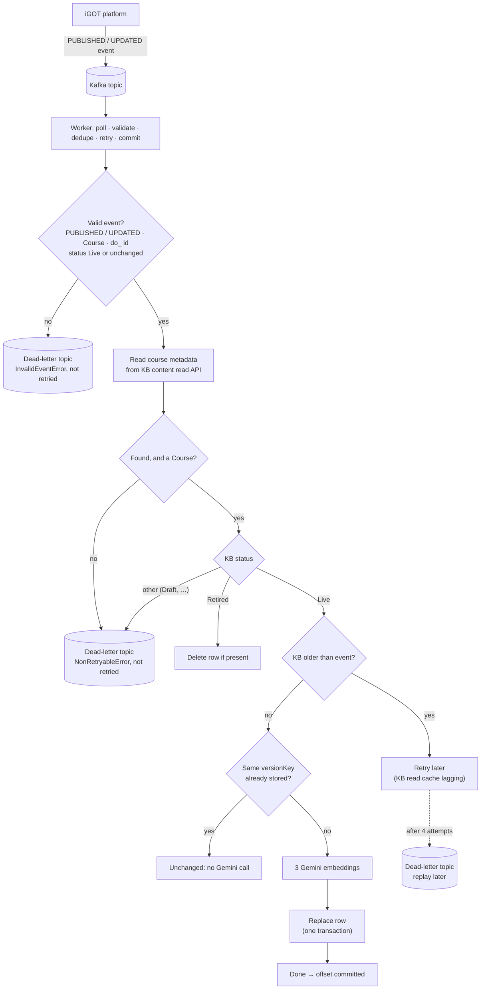
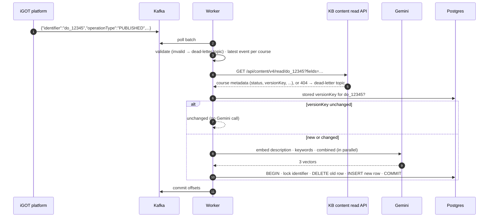

# Course Ingestion: Design

## 1. Problem

CBP recommends courses by searching the course metadata table (`course_metadata_weightage_v2`),
which holds each course's metadata with three embeddings (description, keywords, combined). Today
that table is loaded by a **batch script** from a CSV export:

* someone has to export the CSV and run the script by hand,
* every run processes the **whole** export, even when only a few courses changed,
* new and updated courses stay **invisible to recommendations until the next manual load**
  (days or weeks).

The platform already publishes an event whenever a course is published or updated:

```json
{
  "identifier": "do_12345",
  "operationType": "PUBLISHED",
  "objectType": "Content",
  "primaryCategory": "Course",
  "courseCategory": "Course",
  "contentType": "Course",
  "transactionData": {
    "properties": {
      "status":     {"ov": "Processing",    "nv": "Live"},
      "versionKey": {"ov": "1700000000000", "nv": "1700000005000"}
    }
  }
}
```

---

## 2. Solution: Course ingestion pipeline

A Kafka worker listens for these events and indexes **one course per event**, within seconds of
it being published or updated.

### What it does for each event

| Step | Action |
|---|---|
| 1 | Validate the event: a `PUBLISHED` / `UPDATED` event for a **Course** (`primaryCategory` and `courseCategory` = `Course`) with a `do_…` identifier. **Any other message goes to the dead-letter topic**; nothing is ignored. |
| 2 | Read the course from the **KB content read API** (only the fields needed). The event is only a trigger; KB is the source of truth. |
| 3 | If KB has no such course, it isn't a Course, or its status is neither Live nor Retired, send the event to the dead-letter topic. If it is Retired, delete its row. If the same `versionKey` is already stored, stop: no Gemini cost. |
| 4 | Build three texts and create three embeddings with **Gemini**: description, keywords, combined (name, instructions, source, difficulty, level, competencies). |
| 5 | Replace the course's row in `course_metadata_weightage_v2` in one transaction. |

### Workflow



### End-to-end sequence



### Event validation

Every message on the ingestion topic is checked before KB is called. A message that fails a check is
**not ignored**: it goes straight to the dead-letter topic, without retries, marked
`InvalidEventError` with the reason, so the team can see it, fix the sender and re-publish.

| Check | Rejected example |
|---|---|
| Message is not empty and is valid JSON | empty message, `not json` |
| Message is a JSON object | `"PUBLISHED"` |
| `operationType` is `PUBLISHED` or `UPDATED` | `RETIRED`, `DELETE`, missing |
| `identifier` is a course ID (`do_…`), not a draft image node | missing, `abc-1`, `do_1.img` |
| `primaryCategory` and `courseCategory` are `Course` | `Resource`, `Program` |
| Status, if it changed, changed to `Live` | `Live → Retired`, `Draft → Review` |

Because every other message is treated as invalid, the ingestion topic must carry these events only.

### What is stored per course

| Column | Source |
|---|---|
| Course metadata: `identifier`, `name`, `description`, `instructions`, `keywords`, `organisation`, `language`, `duration`, `difficulty_level`, `course_level`, `competencies_v6`, `course_type` | KB content read API (empty values stored as NULL) |
| `version_key` | KB `versionKey`, used to avoid re-embedding unchanged courses |
| `description_embedding`, `keywords_embedding`, `combined_embedding` | Gemini (`gemini-embedding-2`, 1536 dimensions) |

Example of the combined embedding text:

```
title: Effective Noting & Drafting | text: Name: Effective Noting & Drafting | Instructions: ... |
Source: ISTM | Difficulty Level: Beginner | Course Level: Tactical |
Competencies: [1] Type: Functional -> Theme: Noting and Drafting -> Sub-Theme: ...
```

---

## 3. Key design decisions

**Event is a trigger, KB is the truth.** The pipeline always re-reads the course from the KB
content read API, so duplicate, missed or out-of-order events can't store wrong data.

**Content read API, not search.** The read API is served from the content store, so a course is
readable as soon as it is published; search is fed by a separate index that can lag by seconds to
minutes. Only the fields the pipeline needs are requested (`?fields=…`), about 17 instead of ~90.

**Nothing is silently dropped.** Every message is either processed or sent to the dead-letter topic
with the reason, so a wrong or unexpected event is always visible. See
[Event validation](#event-validation).

**One course per event.** Each event touches one course. Kafka batching, de-duplication (the latest
event per course wins), retries and offset commits are handled by the shared pipeline framework.

**No wasted Gemini calls.** If the stored `versionKey` matches KB, the row is already up to date
(`unchanged`) and Gemini is not called.

**Read cache lag is handled.** If KB still returns an older `versionKey` than the event, the event is
retried after 5s, 10s and 20s, then sent to the dead-letter topic for replay.

**Publish and retire out of order.** If KB already says the course is Retired, its row is deleted
instead of indexed (or left absent if it was never indexed).

**No duplicate rows.** The table has no unique key on `identifier`, so each write takes a per-course
lock and replaces the row in one transaction. The retirement pipeline uses the same lock.

**Schema kept up to date automatically.** At startup the pipeline creates the table and indexes if
missing, and adds any missing metadata columns and indexes to an existing table.

---

## 4. Failure handling

No message is dropped: each one is either processed or ends up in the dead-letter topic.

| Situation | Retried? | What happens |
|---|---|---|
| Invalid message (see validation above) | No | Dead-letter topic immediately (`InvalidEventError`) |
| Course not found in KB (404) | No | Dead-letter topic immediately (`NonRetryableError`) |
| KB content is not a Course, or its status is not Live / Retired | No | Dead-letter topic immediately (`NonRetryableError`) |
| KB returns an older `versionKey` than the event | Yes: 5s, 10s, 20s | Then dead-letter topic |
| KB API error 5xx / timeout, Gemini error or quota, DB connection lost | Yes: 5s, 10s, 20s | Then dead-letter topic |
| KB token rejected (401/403) | — | Worker stops **without** committing; Kubernetes restarts it and nothing is lost |
| Worker crash | — | Offsets not committed, so the batch is re-read; indexing is idempotent |

Messages in the dead-letter topic are replayed with the existing replay job after the cause is
fixed. Invalid messages are not replayed as they are: they would fail again. Fix the sender and
re-publish a corrected event instead.

---

## 5. Performance and cost

| | Batch script (CSV) | Pipeline |
|---|---|---|
| Courses processed per run | The whole CSV export | Only the course in the event |
| Gemini calls | 3 per course in the export | 3 per new or changed course; none when `versionKey` is unchanged |
| Delay before a course can be recommended | Until the next manual load | Seconds |
| Database writes | Batches of rows | One row per event, in a short transaction |

Throughput is set by `PIPELINE_CONCURRENCY` (events in parallel, default 10) and
`EMBEDDING_CONCURRENCY` (Gemini calls in parallel, default 20), within the Gemini quota.

---

## 6. Limits and points to confirm

| Point | Detail |
|---|---|
| **Table** | The pipeline writes `course_metadata_weightage_v2`, the same table the recommendation search reads, so a course is recommendable as soon as it is indexed. |
| **Curated CSV data is replaced on update** | `course_metadata_weightage_v2` was loaded from a curated CSV (`m_*` columns, provider in `source`). When the pipeline re-indexes a course, the whole row is rebuilt from **KB metadata**: a value KB doesn't have becomes NULL, and the `source` column is left empty. Confirm KB carries the same metadata as the curated CSV before go-live. |
| **First event per existing course re-embeds it** | CSV-loaded rows have no `versionKey`, so the first `PUBLISHED` / `UPDATED` event for each of them always re-embeds the course (3 Gemini calls) and replaces the CSV data. |
| **Same embedding text format** | The combined text has the same format as the CSV script, so pipeline rows and CSV rows are searched the same way. Only the source of the values differs (KB vs CSV). |
| **Event format and topic** | Only the format above is accepted; anything else is dead-lettered. Confirm the topic name and format with the platform team, and that the topic carries **only** these events. |
| **Full reload** | Not done by the pipeline; it only reacts to events. The existing CSV load stays the way to rebuild the table, e.g. when the embedding model changes. |

---

## 7. Rollout

1. Confirm the event format and topic with the platform team.
2. Check on staging that the KB content read API returns the same course metadata as the curated
   CSV for a sample of courses.
3. Deploy the ingestion worker (one Deployment; it can scale up to the topic's partition count).
   No initial load is needed: `course_metadata_weightage_v2` is already populated.
4. Monitor logs (`inserted` / `updated` / `unchanged` / `deleted` / `dead_lettered`), consumer lag
   and the dead-letter topic for the first week. Early dead-letters usually mean a format mismatch
   with the sender.
