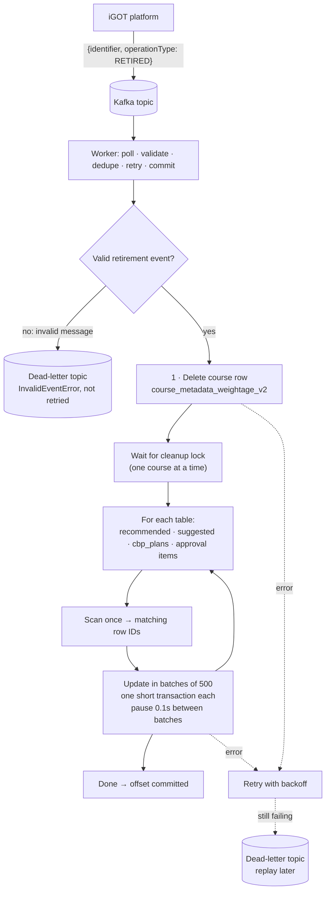
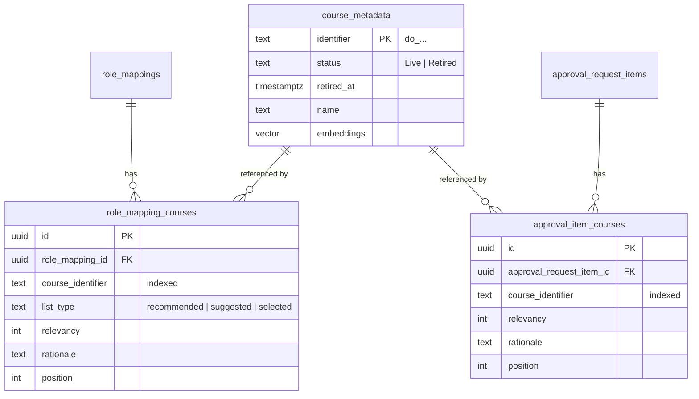
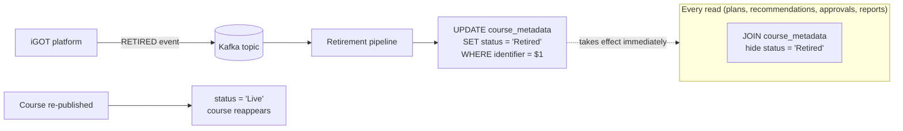

# Course Retirement: Design

## 1. Problem

When a course is retired on iGOT, CBP keeps showing it:

* it can still be **recommended** (its embeddings row is still in the course metadata table),
* it stays in **recommended courses**, **suggested courses** and saved **CBP plans**,
* it stays in plan snapshots sent for **approval**, including approved ones.

Courses are stored as JSON arrays inside these tables, so no index can find them. Today they are
removed by hand with a script run against a CSV of retired course IDs, days or weeks after the
retirement.

Retirement event from the platform:

```json
{"identifier": "do_12345", "operationType": "RETIRED"}
```

### How a course is stored today (example)

The same course `do_12345` is **copied in full** into four tables. Values are illustrative; the
field names are the real ones.

**`course_metadata_weightage_v2`**: one row per course, used for recommendation search.

| identifier | name | course_type | duration | combined_embedding | … |
|---|---|---|---|---|---|
| do_12345 | Effective Noting & Drafting | Course | 3600 | [0.012, -0.044, …] | … |

**`recommended_courses.filtered_courses`**: one JSON array per role mapping, each course copied with
its details.

```json
[
  {
    "identifier": "do_12345",
    "course": "Effective Noting & Drafting",
    "relevancy": 86,
    "rationale": "Builds the drafting skills needed for file work in this role.",
    "is_public": false,
    "course_level": "Beginner",
    "duration": "3600",
    "course_type": "Course",
    "organisation": "ISTM",
    "competencies": [{"competencyAreaName": "Functional", "competencyThemeName": "Noting and Drafting"}]
  },
  { "identifier": "do_67890", "course": "...", "relevancy": 74, "...": "..." }
]
```

**`suggested_courses.course_identifiers`**: a plain list of IDs.

```json
["do_12345", "do_55555"]
```

**`cbp_plans.selected_courses`**: the user's chosen courses, copied again from the recommendation
(plus iGOT-searched and self-added courses).

```json
[
  { "identifier": "do_12345", "course": "Effective Noting & Drafting", "relevancy": 86, "rationale": "...", "...": "..." },
  { "identifier": "3f2b9c1e-...", "name": "Self-added workshop", "relevancy": 70, "...": "..." }
]
```

**`approval_request_items.cbp_plan_data`**: a snapshot of the whole plan at submission, so the course
is copied a third time, nested one level deeper.

```json
[
  {
    "id": "9a1c...",
    "role_mapping_id": "41d7...",
    "selected_courses": [
      { "identifier": "do_12345", "course": "Effective Noting & Drafting", "relevancy": 86, "...": "..." }
    ],
    "created_at": "2026-10-02T10:15:00+00:00"
  }
]
```

To retire `do_12345` today, every one of these arrays has to be searched and rewritten.

---

## 2. Solution 1: Retirement pipeline (implemented)

A Kafka worker listens for the retirement event and removes the course everywhere, automatically,
within seconds.

| Step | Table | Action |
|---|---|---|
| 1 | `course_metadata_weightage_v2` | Delete the course row, so it can't be recommended again |
| 2 | `recommended_courses` | Remove the course from `filtered_courses` |
| 3 | `suggested_courses` | Remove the course ID from `course_identifiers` |
| 4 | `cbp_plans` | Remove the course from `selected_courses` |
| 5 | `approval_request_items` | Remove the course from every plan snapshot, all statuses |

Only the retired course is removed; every other course in the row stays, in the same order.

### Workflow



### Event validation: nothing is silently dropped

Every message on the retirement topic is checked before any database work. A message that fails a
check is **not ignored**: it goes straight to the dead-letter topic, without retries, marked
`InvalidEventError` with the reason, so the team can see it, fix the sender and re-publish.

| Check | Rejected example |
|---|---|
| Message is not empty and is valid JSON | empty message, `not json` |
| Message is a JSON object | `"RETIRED"` |
| `operationType` is `RETIRED` | `PUBLISHED`, missing |
| `identifier` is present and is a course ID (`do_…`) | missing, `123`, `abc-1`, `do_1.img` |

Because every non-retirement message is treated as invalid, the retirement topic must carry
retirement events only. The DLQ alerts then also flag a misbehaving sender.

### Failure handling

No message is dropped: each one is either processed or ends up in the dead-letter topic.

| Situation | Retried? | Result |
|---|---|---|
| Invalid message (see validation above) | No, retrying can't fix it | Dead-letter topic immediately; fix the sender and re-publish |
| Course not in the metadata table and not referenced anywhere | — | Done, nothing to change (`skipped`) |
| Database busy (row locked by a user, scan timeout, connection lost) | Yes: after 5s, 10s, 20s | Dead-letter topic after 4 attempts; replay once the cause is fixed |
| Worker crash mid-way | Batch re-read after restart | Finishes what is left; batches already done stay done |

### How it protects the database

* **One course at a time per pod.** A burst of retirements doesn't become many parallel table scans.
* **One scan per table, returning only row IDs**, using a JSONB containment query (`@>`) that a GIN
  index can answer.
* **Batches of 500 rows**, each in its own short transaction that locks only those rows, with a
  pause between batches. A course used in 60,000 rows becomes 120 small transactions, never one
  large lock.
* **Fails fast.** If a user is editing the same plan, the batch gives up after 5s and is retried
  later instead of blocking the app. Scans are capped at 120s.
* **Safe to repeat.** Every step removes only what is still there, so retries and replays are
  harmless.

### Limits

* **Without GIN indexes**, each event scans the four tables in full, and the cost grows with the
  tables. With them, each scan is an index lookup:

  ```sql
  CREATE INDEX CONCURRENTLY ON recommended_courses    USING gin (filtered_courses jsonb_path_ops);
  CREATE INDEX CONCURRENTLY ON suggested_courses      USING gin (course_identifiers jsonb_path_ops);
  CREATE INDEX CONCURRENTLY ON cbp_plans              USING gin (selected_courses jsonb_path_ops);
  CREATE INDEX CONCURRENTLY ON approval_request_items USING gin ((cbp_plan_data::jsonb) jsonb_path_ops);
  ```

* **Bulk retirements** (thousands of courses at once) are slower than the manual script, which
  scans once for all of them. Use the script for backlogs.
* **Data is deleted.** Approved plan snapshots lose the course, and if a course is re-published it
  doesn't come back into plans.

---

## 3. Solution 2: Normalize course references, mark retired courses (proposed)

Instead of copying courses into JSON arrays in every table, store **one row per course reference**
holding only the course ID and the data that belongs to that reference (relevancy, rationale,
order). Course details come from the course metadata table, which gets a **status** column.

Retiring a course becomes **one UPDATE of one row**. Every read hides retired courses
automatically. Nothing is deleted from any other table.

### Data model



`role_mapping_courses` replaces the JSON arrays in `recommended_courses.filtered_courses`,
`suggested_courses.course_identifiers` and `cbp_plans.selected_courses`, with `list_type` saying
which list a row belongs to. `approval_item_courses` replaces the courses inside
`approval_request_items.cbp_plan_data`.

### The same example after normalization

**`course_metadata`**: the course is stored once, with a status.

| identifier | name | status | retired_at | … |
|---|---|---|---|---|
| do_12345 | Effective Noting & Drafting | Live → **Retired** | 2026-11-20 10:00 | … |

**`role_mapping_courses`**: one small row per reference, holding no copied course details.

| role_mapping_id | course_identifier | list_type | relevancy | rationale | position |
|---|---|---|---|---|---|
| 41d7… | do_12345 | recommended | 86 | Builds the drafting skills… | 1 |
| 41d7… | do_67890 | recommended | 74 | … | 2 |
| 41d7… | do_12345 | suggested | | | 1 |
| 41d7… | do_12345 | selected | 86 | Builds the drafting skills… | 1 |

**`approval_item_courses`**: the snapshot keeps its own rows.

| approval_request_item_id | course_identifier | relevancy | rationale | position |
|---|---|---|---|---|
| 77ab… | do_12345 | 86 | Builds the drafting skills… | 1 |

Retiring `do_12345` changes **one value** (`status`). None of the other rows are touched; reads
simply stop showing them.

### Workflow



### Reading data

```sql
SELECT c.course_identifier, c.relevancy, c.rationale, m.name, m.duration
  FROM role_mapping_courses c
  LEFT JOIN course_metadata m ON m.identifier = c.course_identifier
 WHERE c.role_mapping_id = $1
   AND c.list_type = 'selected'
   AND m.status IS DISTINCT FROM 'Retired'      -- hides retired courses only
 ORDER BY c.position;
```

Recommendation (vector) search adds `WHERE status = 'Live'`.

### Benefits

* **Retirement costs almost nothing:** one indexed UPDATE of one row, no scans or batches,
  whatever the size of the tables.
* **No data is lost:** approved plans keep their full record (good for audit); retired courses are
  just hidden.
* **Reversible:** if a course is re-published, it reappears everywhere automatically.
* **Faster everyday queries:** "which plans use course X", dashboards and reports become simple
  indexed queries instead of JSON scans.
* **One source of truth** for course name and details. Today every JSON copy can go stale.

### Cost and risks

* **Large change:** every place that reads or writes these JSON columns changes: plans,
  recommendations, suggestions, approvals, reports, dashboard (about 100 code references).
* **Data migration:** existing JSON arrays must be copied into the new tables, with a period where
  both are kept in sync, then a switch-over.
* **Course metadata table changes:** it needs a `status` column and a unique key on `identifier`
  (there is no unique constraint today, so duplicates must be cleaned first). The ingestion
  pipeline must set `status` instead of deleting rows.
* **Discipline on reads:** every query must apply the status filter. A database view
  (e.g. `active_courses`) that already applies it lowers that risk.

---

## 4. Comparison

| | Solution 1: Pipeline cleanup | Solution 2: Normalize + status |
|---|---|---|
| Retirement cost | Scan 4 tables + batched updates per course | 1 UPDATE of 1 row |
| Database load | Low with GIN indexes, grows with table size without them | Negligible |
| Data | Course deleted from plans and approvals | Kept and hidden; audit preserved |
| Course re-published | Not restored | Reappears automatically |
| App code changes | None | Large (plans, recommendations, approvals, reports, dashboard) |
| Data migration | None | Yes |
| Time to deliver | Ready now | Multi-sprint |

## 5. Recommendation

1. **Now:** ship Solution 1 with the GIN indexes. It solves the problem today with no app changes.
2. **Next:** plan Solution 2 as the long-term design. Once it is in place, the retirement pipeline
   reduces to the single status update, and the cleanup code is no longer needed.

---

## 6. Points to confirm before go-live

| Point | Why it matters |
|---|---|
| **Course metadata table** | The pipelines use `course_metadata_weightage_v2`, the same table the recommendation search reads, so a deleted row immediately stops the course being recommended. |
| **Event format and topic** | Confirm with the platform team that `{"identifier", "operationType": "RETIRED"}` is published on the configured topic, and that the topic carries **only** retirement events: anything else is dead-lettered as invalid. |
| **Self-added and iGOT-searched courses (Solution 2)** | Plans also contain self-added courses (UUID IDs) and courses found through iGOT search, which may not be in the metadata table. Reads must hide only courses marked Retired; showing only Live ones would drop these. |
| **Approved plans** | Solution 1 changes approved snapshots (as required). Solution 2 keeps them intact and hides the course. Confirm which behaviour the business wants. |
